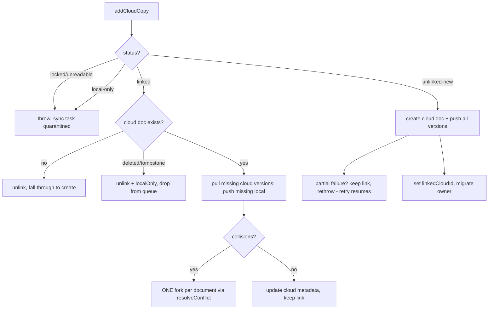

# Architecture

Two things live in this file: what the code is, and where it is going. They are
kept apart on purpose. An earlier version of this document wrote the destination
in the present tense, and readers reasonably took it for a description.

**Where the boundaries are concerned, `eslint.config.js` is the source of truth,
not this file.** Prose cannot be enforced; the lint zones can, and are. What
follows explains them.

---

## Stack

The app is a local-first PWA. Everything is written to IndexedDB first and
synchronised to Postgres afterwards.

| Layer | What runs it |
|---|---|
| Client | React + Vite, served from the VPS behind nginx |
| Data | Supabase (Postgres + RLS + Auth), self-hosted |
| API | A small Node service (`api/`) on the same VPS, systemd unit, loopback only |
| AI provider | RouterAI, called server-side only |

---

## Directory structure

- `src/app/` — bootstrapping, routing, global providers.
- `src/core/` — infrastructure shared across features: Supabase client, crypto,
  IndexedDB schema, data provider, errors, sync, theme.
- `src/features/` — domain modules: `admin`, `ai`, `archive`, `auth`,
  `encryption`, `navigation`, `profile`, `settings`, `writing`.
- `src/shared/` — stateless UI, design system, pure utilities, prompt sources.
- `api/` — the server: `server.ts` (routing), `dispatcher.ts` + `handlers.ts`
  (the non-streaming AI endpoints), `chat.ts` (streaming chat), `auth.ts` (JWT
  verification), `account.ts` (deletion and telemetry), `postgresAiContext.ts`
  (consent checks and AI limits in Postgres), `admin/` (invites, user list),
  `ai/` (the AI logic).
- `supabase/` — migrations, RLS policies, and the SQL test suite.

The contents of `src/core/services/` are deliberately not listed here. A
hand-maintained inventory drifts within a month; the previous one claimed eight
services when there were twenty-three.

---

### Sync decision map (AUDIT-part2 5.3)

`CloudSyncService.addCloudCopy` / `syncVersionToCloud` — ~12 ветвлений вида
«если X, вернуть '' / unlink / форкнуть». Интерпретация флагов документа —
только через `syncStatusOf()` (`src/core/sync/syncStatus.ts`); читать флаги
напрямую (`linkedCloudId`, `localOnly`, `_locked`) в новых ветках нельзя.

Инвариант движка («один локальный документ = один облачный, ноль форков в
мирном пути») фиксирует `syncCycleInvariant.test.ts`.

## Layer boundaries

Enforced by `import/no-restricted-paths` in `eslint.config.js`:

| Rule | Opt-outs |
|---|---|
| `shared` must not import `core` or `features` | 0 |
| `core` must not import `features` | 0 |
| a feature must not import another feature, except `features/auth` | 0 |
| `features/auth` must not import any other feature | 0 |

`features/auth` is the one sanctioned exception: the session provider every
feature consumes. Imports from the composition layer (`src/app/*`) into
features are not violations: wiring the app together is that layer's job.
There is no `eslint-disable` for this rule anywhere in `src/`.

The rule is switched off for test files, so a test reaching across a boundary is
not a violation.

`scripts/cross-feature-check.sh` runs in CI as a second guard and fails above
the count in `scripts/cross-feature-baseline.txt`, which is 0.

`import/no-cycle` is an error. It needs module resolution, so
`eslint.config.js` configures `import/parsers` for `.ts`/`.tsx` and
`eslint-import-resolver-typescript`; without them the rule was inert
(`LINT-1` in `TASKS.md`, closed).

---

## Data

### Local (IndexedDB, via `idb`)

`documents`, `versions`, `drafts`, `profile`, `syncQueue`, `pending_sessions`,
plus the AI stores (`aiSummaries`, `aiEmbeddings`, `aiDialogues`, `aiThreads`,
`aiPortrait`, `aiProfileFacets`, `aiBeliefs`, `aiChatMemory`, and others). The
schema and its upgrade path live in `src/core/storage/localDb.ts`; the version
number there is the one that matters, and raising it invalidates stale service
worker bundles.

### Cloud (Supabase Postgres)

`users`, `documents`, `versions`, `drafts`, `ai_summaries`, `ai_embeddings`,
`ai_daily_limit`, `ai_cooldown`, `ai_usage`, `ai_global_daily`,
`telemetry_cooldown`, `anonymized_telemetry`, `local_store_records`,
`applied_migrations`, `connection_test`.

Every table has row-level security enabled, and every policy is scoped by
`auth.uid()`. Server-only tables are deny-all. `supabase/tests/rls.test.sql`
checks this against a real Postgres; it is the only test the vitest suite cannot
run, and CI runs it in its own job.

### Sync

Cloud sync is off until the person turns it on: `cloudSyncEnabled()`
(`src/core/sync/cloudSyncEnabled.ts`) reads `auto_sync_enabled_<uid>`, and
silence means no. Explicit buttons ("send all notes to the cloud") run
regardless of the toggle. With the vault locked, both directions skip and
report `locked`.

Up:

1. Writes land in IndexedDB first; the upload is a task in `syncQueue`.
2. `SyncService.syncPending` drains the queue — on vault unlock, on reconnect,
   and on every `useBackgroundSync` pass (on idle after start, every 120 s, on
   return to the tab). Without `force` it respects the toggle.
3. The same pass enqueues notes that have neither a cloud copy nor a task
   (`sweepOrphanedDocuments`) and flushes the AI stores
   (`LocalStoreSyncService`) and vectors.

Down:

4. `downloadAllFromCloud` fetches cloud notes this device does not have (not
   linked, uuid unknown) — at sign-in, on reconnect, on vault unlock.
5. `reconcileLinkedDocuments` refreshes linked notes whose cloud copy is newer.
   No pending local edit and not open in the editor: silent fast-forward.
   Otherwise the cloud version is added to the note's history and the screen
   is left alone. Both 4 and 5 run from `checkAndSyncCursor`
   (`src/core/sync/changeCursor.ts`) when the tab regains focus and the
   server's change cursor is ahead; the cursor moves only if both passes
   finished clean.
6. Once a day per account the background pass restores notes and analyses
   missing from the device (`restoreMissingDocuments`,
   `restoreAIDataFromCloud`); analyses and dialogues changed on another device
   are pulled on every pass.

Conflicts: when an upload finds the cloud copy has moved,
`ConflictResolver.resolveConflict` forks the local note into a copy titled
`<title> (conflict, <date> <time>: <preview>…)` — one fork per document, see
the map above.

---

## Encryption

AES-256-GCM with an envelope scheme:

1. Password → PBKDF2, **600 000 iterations** → master key (AES-KW).
   Vaults created before the raise carry 300 000 and are migrated on unlock.
2. A random AES-256-GCM data key is generated per vault.
3. The data key is wrapped with the master key and stored on the profile row.
4. Content is encrypted with the data key; every record gets a fresh IV.
5. A verification plaintext proves the password without revealing the key.
6. The session key lives in memory (`useEncryptionStore`) while the vault is
   unlocked, auto-locks after inactivity, and is non-extractable.

Note bodies, titles, tags, mood and label names are encrypted in the cloud.
Dates, word counts and structural metadata are not, by design.

---

## Server

`api/server.ts` binds to `127.0.0.1` only; nginx is the sole way in. Every
request is authenticated by verifying a Supabase JWT (`api/auth.ts`, HS256
pinned, audience and issuer checked).

- `POST /api/chat` — streaming chat.
- `POST /api/<name>` — the dispatcher, covering `chatWithAI`, `editWithAI`,
  `summarizeDocument`, `summarizeFacet`, `judgeFacets`, `judgeBeliefCandidate`,
  `summarizeBeliefCluster`, `rerankNotes`, `embedDocument`, `extractChatMemory`,
  `deriveTaxonomy`, `validateCustomPrompt`, `getAIUsageStats`, `getAiQuota`,
  `deleteAccount`, `sendTelemetry`, and the admin-only `inviteUser`,
  `listUsersWithStatus`.
- `POST /api/csp-report`, `GET /health`, `GET /ready` (database and
  embedding-server config).

Every AI call passes three gates: a per-user daily limit, a cooldown between
calls, and a global daily cap on requests and tokens. Internal calls (`callType`)
are charged to a separate bulk counter — they are cheaper, not free. Input is
checked for prompt injection and sanitised before it reaches the provider.

There is no App Check and no bot protection: it left with Firebase and has no
replacement yet (`D2` in `docs/migration-plan.md`).

---

## Patterns

- **`/archive` and `/writing` are intentionally public routes.** The app works
  without an account: guest notes live locally under `guest_*` ids
  (`getOrCreateGuestId`, `LocalStorageService.getDocumentsByOwner`), and
  `/archive` is the only place a guest can see what they wrote. Do not wrap
  them in `ProtectedRoute` — that would lock guests out of their own notes.
  `/ai` is protected because it requires server calls, not because the other
  pages were forgotten. (Decision recorded after the 2026-08-24 audit, item M8.)

- **Services hold the logic.** Components render and collect input; they do not
  touch the database. Logic in services stays testable without React.
- **Zustand** for high-frequency cross-component state (timer, content,
  encryption keys); **React Context** for provider-scoped, low-frequency state
  (auth, settings, modals).
- **One copy of the AI prompt/sanitization logic** lives in `src/shared/ai/`
  (`prompts`, `buildChatPrompt`, `injectionPatterns`, `aiPolicy`, `context`);
  both the client and the VPS service import it. The former duplicates in
  `api/ai/` and `functions/src/shared/` are gone (C4 + AG-AIONE-1).
  `api/ai/pure.ts` keeps only the genuinely server-only parts
  (isomorphic-dompurify output sanitisation, the limit constants) on top of
  the shared core.
