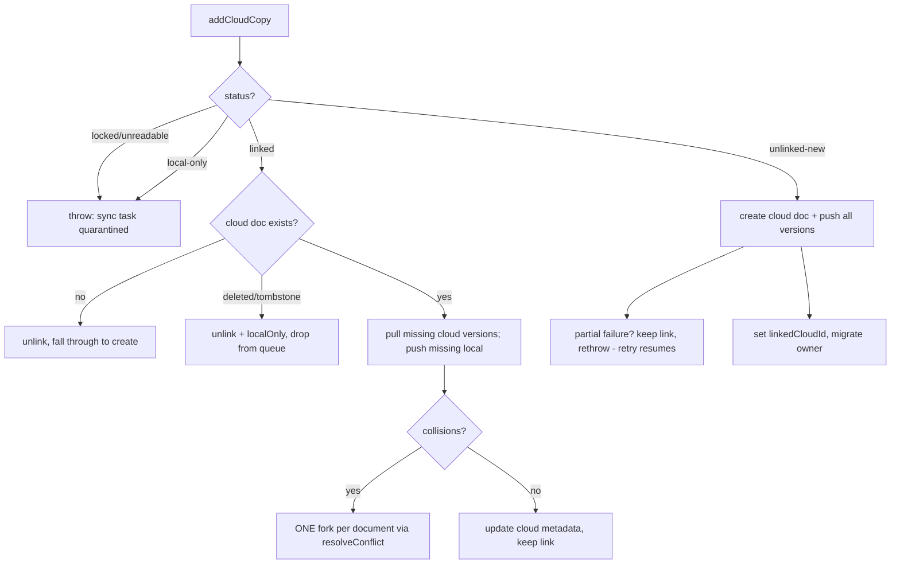

# Architecture

Two things live in this file: what the code is, and where it is going. They are
kept apart on purpose. An earlier version of this document wrote the destination
in the present tense, and readers reasonably took it for a description.

**Where the boundaries are concerned, `eslint.config.js` is the source of truth,
not this file.** Prose cannot be enforced; the lint zones can, and are. What
follows explains them.

---

## Stack

The app is a local-first PWA. Everything is written to IndexedDB first and
synchronised to Postgres afterwards.

| Layer | What runs it |
|---|---|
| Client | React + Vite, served from the VPS behind nginx |
| Data | Supabase (Postgres + RLS + Auth), self-hosted |
| API | A small Node service (`api/`) on the same VPS, systemd unit, loopback only |
| AI provider | RouterAI, called server-side only |

---

## Directory structure

- `src/app/` — bootstrapping, routing, global providers.
- `src/core/` — infrastructure shared across features: Supabase client, crypto,
  IndexedDB schema, data provider, errors, sync, theme.
- `src/features/` — domain modules: `admin`, `ai`, `archive`, `auth`,
  `calendar`, `encryption`, `export`, `navigation`, `profile`, `settings`,
  `sync`, `writing`.
- `src/shared/` — stateless UI, design system, pure utilities, prompt sources.
- `api/` — the server: `server.ts` (routing), `dispatcher.ts` + `handlers.ts`
  (the non-streaming AI endpoints), `chat.ts` (streaming chat), `auth.ts` (JWT
  verification), `account.ts` (deletion and telemetry), `ai/` (the AI logic).
- `supabase/` — migrations, RLS policies, and the SQL test suite.

The contents of `src/core/services/` are deliberately not listed here. A
hand-maintained inventory drifts within a month; the previous one claimed eight
services when there were twenty-three.

---

### Sync decision map (AUDIT-part2 5.3)

`CloudSyncService.addCloudCopy` / `syncVersionToCloud` — ~12 ветвлений вида
«если X, вернуть '' / unlink / форкнуть». Интерпретация флагов документа —
только через `syncStatusOf()` (`src/core/sync/syncStatus.ts`); читать флаги
напрямую (`linkedCloudId`, `localOnly`, `_locked`) в новых ветках нельзя.



Инвариант движка («один локальный документ = один облачный, ноль форков в
мирном пути») фиксирует `syncCycleInvariant.test.ts`.

## Layer boundaries

Four rules, enforced by `import/no-restricted-paths` in `eslint.config.js`:

| Rule | Enforced | Violations |
|---|---|---|
| `shared` must not import `core` or `features` | yes | 2, each an explicit opt-out |
| `core` must not import `features` | yes | 5, each an explicit opt-out |
| `features/auth` must not import other features | yes | 0 |
| `features/calendar` must not import other features | yes | 0 |

The rule is switched off for test files, so a test reaching across a boundary is
not a violation and will not show up in these counts.

### Cross-feature imports are held by a ratchet

Cross-feature imports inside `src/features/` (~48 across ~35 files as of
2026-08-26) cannot grow: `scripts/cross-feature-check.sh` fails CI above the
count in `scripts/cross-feature-baseline.txt`. The per-feature
`import/no-restricted-paths` zones are written in `eslint.config.js` but stay
disabled until the count reaches zero; the sanctioned exception will be
`features/auth` — the session domain provider every feature legitimately
consumes. Imports from the composition layer (`src/app/*`) into features are
not violations: wiring the app together is that layer's job.

Detection note (AUDIT-part3 9): the first ratchet version counted only
`../features/x`-shaped imports and missed the dominant class — sibling
features reached via `../../<feature>/`. v2 enumerates feature directories and
matches any sibling import; the baseline was re-measured with it.

### The seven bridges

`src/core/services/` holds five one-line re-export shims pointing back into
`features/` — `AIService`, `AISummaryService`, `AIEmbeddingService`,
`ProfileServiceRef`, `UnifiedSessionLoader` — and `src/shared/components/` holds
two more, `Calendar` and `StorageIcons`. Each carries an explicit

```ts
// eslint-disable-next-line import/no-restricted-paths -- re-export bridge for cross-feature access
```

They are the mechanism by which one feature reaches another's service without
importing it directly, so they implement the rule rather than break it. The
dependency direction is inverted all the same: `core` re-exports code it does
not own. If one of these grows past a re-export, that is the signal to move the
implementation down into `core` instead.

### Known gap

`import/no-cycle` is configured as an error and **does not fire** — the
`eslint-import-resolver-typescript` package is absent, so every rule that needs
module resolution is inert while the path-string rules above keep working.
There are five real cycles today, all inside a single feature. Tracked as
`LINT-1` in `TASKS.md`. Do not read a green lint run as "no cycles".

---

## Data

### Local (IndexedDB, via `idb`)

`documents`, `versions`, `drafts`, `profile`, `syncQueue`, `pending_sessions`,
plus the AI stores (`aiSummaries`, `aiEmbeddings`, `aiDialogues`, `aiThreads`,
`aiPortrait`, `aiProfileFacets`, `aiBeliefs`, `aiChatMemory`, and others). The
schema and its upgrade path live in `src/core/storage/localDb.ts`; the version
number there is the one that matters, and raising it invalidates stale service
worker bundles.

### Cloud (Supabase Postgres)

`users`, `documents`, `versions`, `drafts`, `ai_summaries`, `ai_embeddings`,
`ai_daily_limit`, `ai_cooldown`, `ai_usage`, `ai_global_daily`,
`telemetry_cooldown`, `anonymized_telemetry`, `local_store_records`,
`applied_migrations`, `connection_test`.

Every table has row-level security enabled, and every policy is scoped by
`auth.uid()`. Server-only tables are deny-all. `supabase/tests/rls.test.sql`
checks this against a real Postgres; it is the only test the vitest suite cannot
run, and CI runs it in its own job.

### Sync

1. Writes land in IndexedDB first.
2. `syncVersionToCloud` pushes versions up.
3. Offline writes go to `syncQueue` and drain on reconnect.
4. If the cloud version is at or ahead of the local one, the local document is
   forked into a copy titled `… (Conflict <date>)`.

> **This flow only goes up.** A document already linked to a cloud copy is never
> read back down — `downloadAllFromCloud` skips linked documents and no other
> path refreshes them. Four data-loss symptoms follow from that single fact, and
> they are one bug, not four: see `docs/ag-sync5-upload-only-sync-ticket.md`.
> Treat the description above as the current behaviour, not as the design.

---

## Encryption

AES-256-GCM with an envelope scheme:

1. Password → PBKDF2, **600 000 iterations** → master key (AES-KW).
   Vaults created before the raise carry 300 000 and are migrated on unlock.
2. A random AES-256-GCM data key is generated per vault.
3. The data key is wrapped with the master key and stored on the profile row.
4. Content is encrypted with the data key; every record gets a fresh IV.
5. A verification plaintext proves the password without revealing the key.
6. The session key lives in memory (`useEncryptionStore`) while the vault is
   unlocked, auto-locks after inactivity, and is non-extractable.

Note bodies, titles, tags, mood and label names are encrypted in the cloud.
Dates, word counts and structural metadata are not, by design.

---

## Server

`api/server.ts` binds to `127.0.0.1` only; nginx is the sole way in. Every
request is authenticated by verifying a Supabase JWT (`api/auth.ts`, HS256
pinned, audience and issuer checked).

- `POST /api/chat` — streaming chat.
- `POST /api/<name>` — the dispatcher, covering `chatWithAI`, `editWithAI`,
  `summarizeDocument`, `summarizeFacet`, `judgeFacets`, `judgeBeliefCandidate`,
  `summarizeBeliefCluster`, `rerankNotes`, `embedDocument`, `extractChatMemory`,
  `deriveTaxonomy`, `validateCustomPrompt`, `getAIUsageStats`, `deleteAccount`,
  `sendTelemetry`.
- `POST /api/csp-report`, `GET /health`.

Every AI call passes three gates: a per-user daily limit, a cooldown between
calls, and a global daily cap on requests and tokens. Internal calls (`callType`)
are charged to a separate bulk counter — they are cheaper, not free. Input is
checked for prompt injection and sanitised before it reaches the provider.

There is no App Check and no bot protection: it left with Firebase and has no
replacement yet (`D2` in `docs/migration-plan.md`).

---

## Patterns

- **`/archive` and `/writing` are intentionally public routes.** The app works
  without an account: guest notes live locally under `guest_*` ids
  (`getOrCreateGuestId`, `LocalStorageService.getDocumentsByOwner`), and
  `/archive` is the only place a guest can see what they wrote. Do not wrap
  them in `ProtectedRoute` — that would lock guests out of their own notes.
  `/ai` is protected because it requires server calls, not because the other
  pages were forgotten. (Decision recorded after the 2026-08-24 audit, item M8.)

- **Services hold the logic.** Components render and collect input; they do not
  touch the database. Logic in services stays testable without React.
- **Zustand** for high-frequency cross-component state (timer, content,
  encryption keys); **React Context** for provider-scoped, low-frequency state
  (auth, settings, modals).
- **One copy of the AI prompt/sanitization logic** lives in `src/shared/ai/`
  (`prompts`, `buildChatPrompt`, `injectionPatterns`, `aiPolicy`, `context`);
  both the client and the VPS service import it. The former duplicates in
  `api/ai/` and `functions/src/shared/` are gone (C4 + AG-AIONE-1).
  `api/ai/pure.ts` keeps only the genuinely server-only wrappers
  (Langfuse, isomorphic-dompurify, node-crypto hashUid) on top of the shared
  core.
